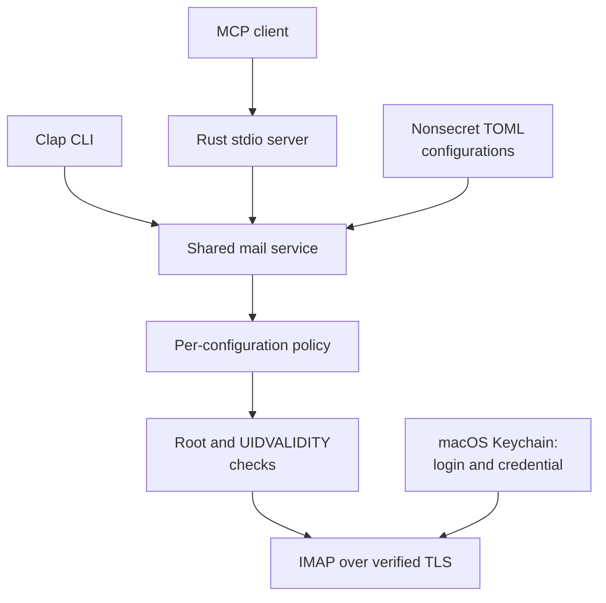

# Design

The CLI and server connect local callers to explicitly configured IMAP roots.

[Access and operations](access.md) owns the `policy`, `folder`, and `message`
capabilities, and the `interface` and `cli` capabilities. [Authentication and configurations](authentication.md) owns `auth`
and `config`, and the authentication chapter also owns `oauth`. Mail content is untrusted data. Tool instructions never grant
additional access. MCP uses stdio; CLI operations print JSON to stdout and
diagnostics go to stderr.
